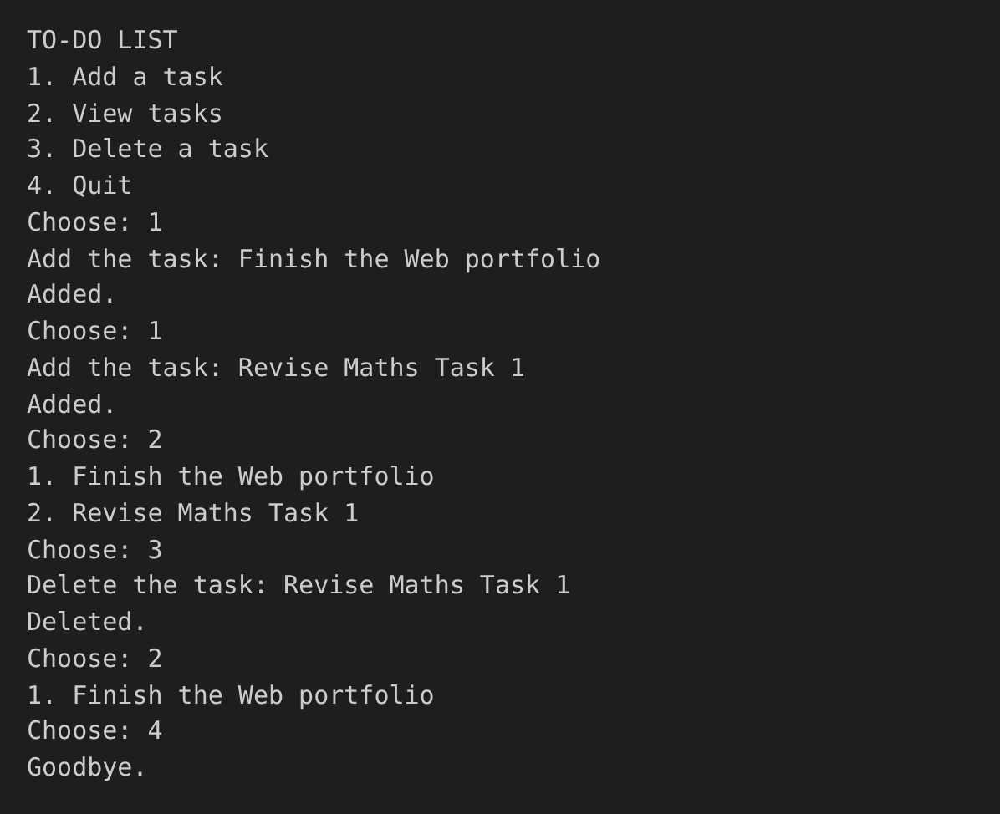

# Terminal To-Do List

A to-do list that runs in the terminal: add, view and delete tasks from a simple menu. Your tasks are saved in `tasks.json`, so they are still there the next time you run it.



## How to run it

You need Python 3. In PowerShell or cmd:
```
git clone https://github.com/bhargavsaideekonda/terminal-todo-list.git
cd terminal-todo-list
python todo.py
```
Choose 1 to add, 2 to view, 3 to delete and 4 to quit.

## What I built myself

- A menu inside a `while True` loop that keeps running until you choose 4.
- Saving and loading with the `json` module: the list is written to `tasks.json` after every change and read back when the program starts (`os.path.exists` checks the file is there first).
- Input checks: `try`/`except ValueError` catches a menu choice that isn't a number, and deleting a task that isn't on the list says "Not there in the task." Deleting a task removes every copy of it.

I built this with step-by-step help from Claude, an AI tutor. I typed and ran every line myself.
